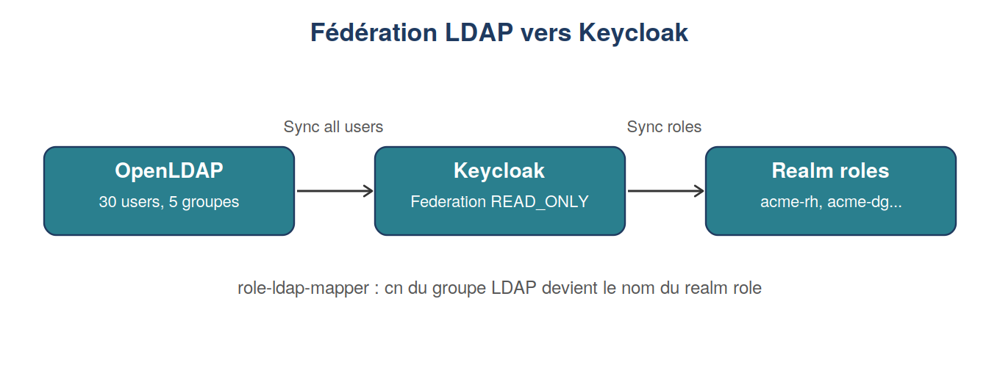

# Module 3 : Annuaires LDAP

Duree : ~4 h

## Realise
- [x] OpenLDAP ajoute au compose, sur le reseau `iam-net`
- [x] Fichier LDIF de 30 utilisateurs et 5 groupes (`acme-dg`, `acme-rh`, `acme-marketing`,
      `acme-ventes`, `acme-it-admin`), avec mots de passe haches (SSHA)
- [x] 3 filtres `ldapsearch` testes : egalite simple, ET logique, appartenance a un groupe
- [x] Federation LDAP configuree dans Keycloak, en lecture seule (`READ_ONLY`)
- [x] Mapper de roles : les groupes LDAP sont synchronises vers les roles Keycloak

## Fichiers
- `docker-compose.yml`, `.env.example`
- `ldif/01-acme.ldif` : les 30 utilisateurs et 5 groupes de l'annuaire

## Verification
Les 5 personas se connectent desormais via l'annuaire (mot de passe commun de demonstration,
voir `.env.example` du module). Leur Federation link `ldap-acme` est visible dans la console.

