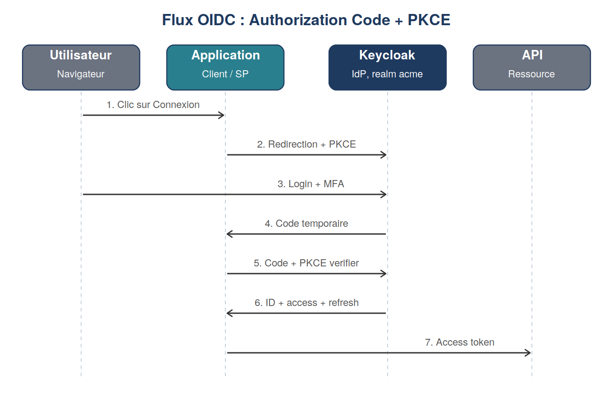

# Module 4 : OAuth 2.0 et OpenID Connect

Duree : ~5 h

## Realise
- [x] Token recupere avec curl en client credentials (client `lab-m2m`)
- [x] Flow Authorization Code + PKCE teste avec Postman (client `postman-client`)
- [x] JWT decode et signature verifiee via le JWKS de Keycloak (access token et ID token)
- [x] Grafana branche en SSO OIDC (client `grafana`, mapping des roles par claim)
- [x] Claim personnalise `department` ajoute via un mapper LDAP + client scope

## Fichiers
- `docker-compose.yml`, `.env.example` : service Grafana

## A retenir
- Un jeton `client_credentials` n'a ni refresh token ni ID token : il represente l'application
  elle-meme, pas un utilisateur.
- Les jetons "allegges" (`lightweight access token`) de certains clients integres (comme
  `admin-cli`) ne conviennent pas pour `/userinfo` : un client de test dedie (`lab-cli`) a ete
  cree pour les scripts.

