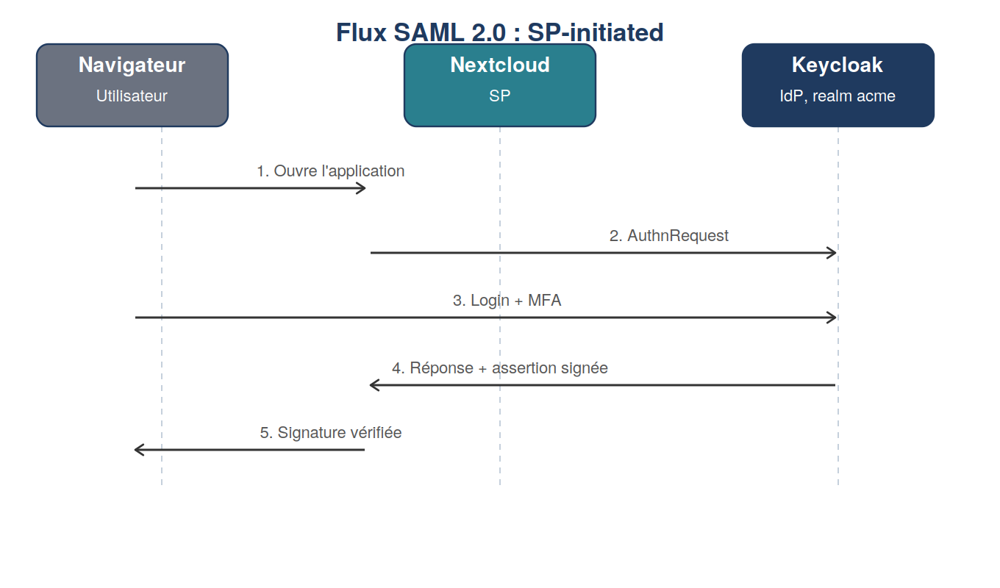

# Module 5 : SAML 2.0

Duree : ~3 h

## Realise
- [x] Client SAML configure dans Keycloak (signature des assertions, NameID = username)
- [x] Nextcloud branche en SAML (SP-initiated et IdP-initiated testes)
- [x] Assertion inspectee avec l'extension SAML-tracer (AuthnRequest, Response, Assertion, signature)
- [x] Tableau comparatif SAML vs OIDC redige, avec observations reelles du lab

## Fichiers
- `docker-compose.yml`, `.env.example` : service Nextcloud
- `saml-vs-oidc.md` : comparatif detaille

## Mini-projet associe
Grafana (OIDC) et Nextcloud (SAML) partagent la meme session Keycloak : connexion unique,
deux protocoles differents. Voir `module-10-capstone` pour la preuve finale (une seule session,
deux clients).

