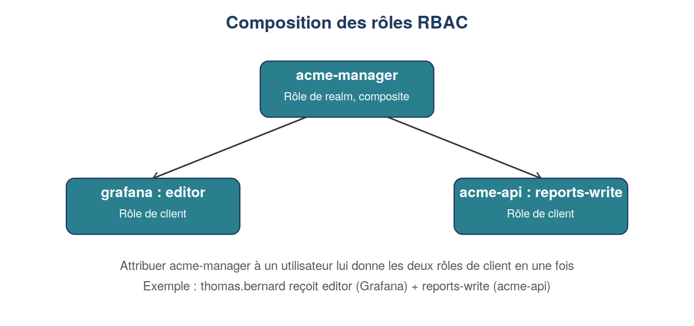

# Module 7 : Autorisation, RBAC et ABAC

Duree : ~4 h

## Realise
- [x] Groupes mappes vers des roles applicatifs (Grafana : viewer/editor/admin ; API : reports-read/write/admin)
- [x] Role composite `acme-manager` cree (contient `grafana editor` + `acme-api reports-write`)
- [x] Ressource et politique creees dans Authorization Services (RBAC par role + ABAC par attribut `department`)
- [x] API Flask (`acme-api`) qui verifie les roles presents dans le JWT

## Fichiers
- `api/app.py` : API Flask, verification JWT via JWKS
- `docker-compose.yml`, `.env.example`
- `matrice-roles-applications.md` : matrice roles x applications, testee par script

## Matrice finale

| Role | Grafana | API : lire | API : ecrire | API : supprimer |
|---|---|---|---|---|
| Tous | viewer | oui | non | non |
| acme-marketing | editor | oui | non | non |
| acme-ventes | viewer | oui | oui | non |
| acme-manager | editor | oui | oui | non |
| acme-it-admin | admin | oui | non | oui |

## Code

- src/app.py : API Flask qui vérifie les rôles présents dans le JWT (JWKS, RS256)

