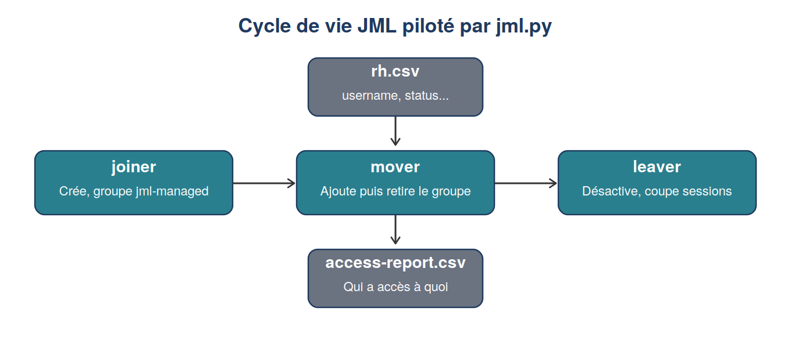

# Module 8 : Automatisation et cycle de vie (JML)

Duree : ~5 h

## Realise
- [x] CLI Python `jml.py` : creation d'utilisateur (Joiner)
- [x] Changement de departement (Mover), avec ajout avant retrait du groupe (jamais sans acces)
- [x] Desactivation et coupure de sessions (Leaver)
- [x] Lecture et synchronisation d'un CSV RH en masse
- [x] Export du rapport "qui a acces a quoi" (`access-report.csv`)

## Fichiers
- `jml.py` : CLI complete (joiner, mover, leaver, sync, report)
- `test_jml.py` : 19 tests unitaires, avec une fausse API Keycloak en memoire
- `rh.csv`, `rh-v2.csv` : exemples de fichiers RH pour la synchronisation

## Principes de conception
- Idempotence : relancer une commande sans changement ne fait rien.
- Perimetre limite : seuls les comptes du groupe `jml-managed` sont modifies, jamais les
  comptes de l'annuaire LDAP.
- Compte de service dedie (`jml-cli`), avec uniquement les droits `realm-management`
  necessaires (pas le mot de passe administrateur).

## Code

- src/jml.py : CLI Joiner / Mover / Leaver
- 	ests/test_jml.py : 19 tests unitaires (fausse API Keycloak en mémoire)

